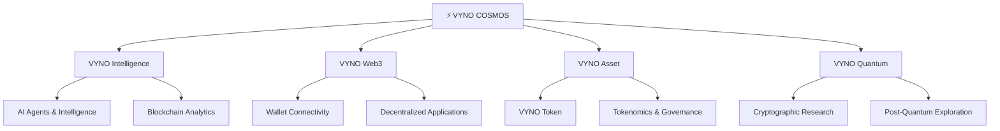
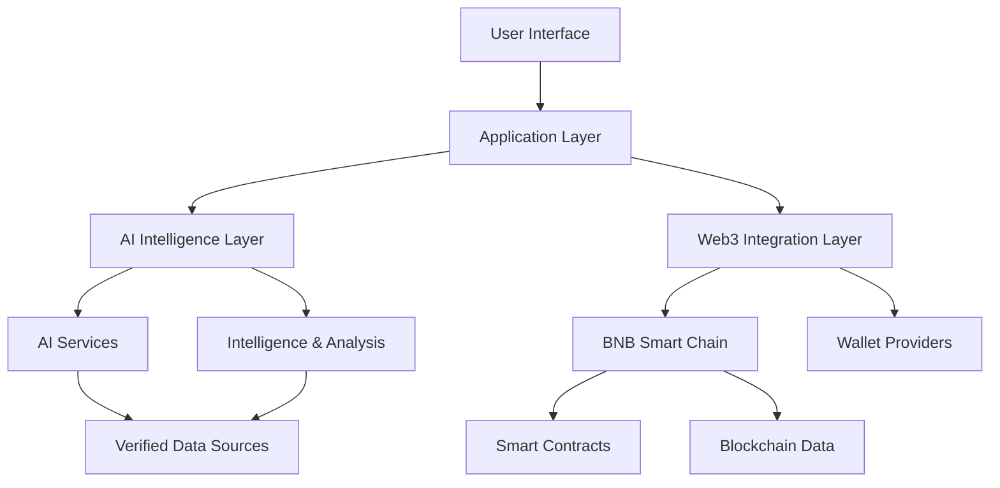

 

# ⚡ VYNO COSMOS

### THE INTELLIGENCE OF DIGITAL ASSETS.

  

### ENGINEERING THE NEXT DIGITAL FRONTIER.

**ARTIFICIAL INTELLIGENCE × BLOCKCHAIN × DIGITAL ASSETS × AUTONOMOUS SYSTEMS**

Building an intelligent digital ecosystem where AI, decentralized infrastructure, cryptographic research and digital assets converge.

[**VANHSYA**](https://www.vanhsya.com/) · [**VYNO Contract**](https://bscscan.com/token/0xe7c0e2229957300efcedd7455eda931f55bd7b10) · **Documentation** · **Roadmap**

 

---

# 🌌 01. THE VISION

**VYNO COSMOS** is an AI-powered Web3 technology initiative designed to bring intelligent software, blockchain infrastructure and digital asset intelligence into one connected ecosystem.

The project explores a new generation of interconnected technologies:

- Artificial intelligence and autonomous intelligence systems.
- Blockchain infrastructure and decentralized applications.
- Digital asset analytics and token intelligence.
- Non-custodial wallet connectivity.
- Smart contract security intelligence.
- Decentralized governance and transparent systems.
- Quantum-inspired research and post-quantum cryptography exploration.

Our long-term objective is to build an intelligent digital environment in which users can interact with blockchain technology through accessible, secure and intelligent software.

> **One ecosystem. Multiple technologies. A connected digital future.**

# 🧬 02. THE VYNO ECOSYSTEM

VYNO COSMOS is the overarching ecosystem identity. Its technology domains are designed to work together while retaining clearly defined responsibilities.

| Division | Purpose |
|---|---|
| **VYNO Intelligence** | AI systems, research, assistants and blockchain intelligence |
| **VYNO Web3** | Blockchain connectivity, decentralized applications and Web3 infrastructure |
| **VYNO Asset** | VYNO digital token and related asset ecosystem |
| **VYNO Quantum** | Quantum-inspired computing research and post-quantum security exploration |

### Ecosystem architecture

# 🤖 03. VYNO INTELLIGENCE

**VYNO Intelligence** represents the artificial intelligence layer of the ecosystem.

Its objective is to make complex blockchain and digital asset information easier to understand, analyze and interact with.

### Research and development areas

- AI-powered digital asset research.
- Blockchain data interpretation.
- Intelligent conversational interfaces.
- Autonomous agent architecture.
- Voice-enabled AI interaction.
- Security intelligence and anomaly analysis.
- AI-assisted portfolio insights.

AI-generated information must be distinguished from verified blockchain data. AI is intended to interpret information, not independently establish token balances, transaction finality or asset ownership.

# ⛓️ 04. VYNO WEB3

**VYNO Web3** is the decentralized technology layer.

The initial blockchain strategy is BNB Smart Chain, with potential expansion to additional networks after technical and security evaluation.

### Planned technology modules

| Module | Description |
|---|---|
| Blockchain Explorer | Transaction, address and token information |
| Wallet Integration | Non-custodial wallet connectivity |
| Asset Intelligence | Digital asset information and analytics |
| Smart Contract Intelligence | Contract inspection and security information |
| Governance | Transparent proposal and voting infrastructure |
| Treasury | Controlled and auditable treasury operations |
| Multichain | Future network integrations |

All blockchain operations must use verified network data and explicit user authorization.

# 🪙 05. VYNO ASSET

**VYNO** is the digital asset associated with the ecosystem.

### Token information

| Property | Information |
|---|---|
| Token name | VYNO |
| Ecosystem | VYNO COSMOS |
| Blockchain | BNB Smart Chain |
| Network type | EVM-compatible |
| Chain ID | `56` |
| Contract address | `0xe7c0e2229957300efcedd7455eda931f55bd7b10` |
| Explorer | [View on BscScan](https://bscscan.com/token/0xe7c0e2229957300efcedd7455eda931f55bd7b10) |
| Logo | [View IPFS asset](https://gateway.pinata.cloud/ipfs/bafybeicqmuupjqbwigxxb4vgwormcxiq5yq3ryndgznxij2pazdxqwk7fi) |

**Important:** The contract address above identifies the token contract supplied for this project. Always independently verify the contract, token metadata, liquidity and trading information before interacting with the asset.

### Digital asset development direction

- Token information and transparency.
- Blockchain-based asset tracking.
- Market data integration.
- Token utility research.
- Governance architecture.
- Potential staking architecture, subject to economic design and independent security review.

No staking yield, rewards, token value or financial return is guaranteed.

# 🔐 06. SECURITY FIRST

Security is a foundational requirement of VYNO COSMOS.

The project follows a security-first development philosophy:

- Non-custodial wallet architecture wherever applicable.
- No collection or storage of users' seed phrases or private keys.
- Secure handling of API credentials and environment variables.
- Explicit authorization for transactions.
- Smart contract testing and independent security review before production deployment.
- Input validation and API protection.
- Transparent reporting of security limitations.
- Separation of AI-generated interpretations from verified blockchain records.

### Security principle

**Your keys remain yours. Your transactions require your authorization.**

# 🧠 07. VYNO QUANTUM

**VYNO Quantum** is the research domain focused on exploring future cryptographic and computational technologies.

Research directions include:

- Quantum-inspired computational approaches.
- Post-quantum cryptography research.
- Cryptographic algorithm evaluation.
- Future blockchain security considerations.
- Emerging approaches to digital identity and verification.

This is a research direction, not a claim that the platform currently operates a quantum computer or implements certified post-quantum security.

# 🏗️ 08. TECHNOLOGY ARCHITECTURE

The ecosystem is designed around modular components that can evolve independently.

### Architecture principles

1. Modular development.
2. Secure API boundaries.
3. Clear separation of frontend and backend responsibilities.
4. Verified blockchain data.
5. Non-custodial wallet interaction.
6. Scalable infrastructure.
7. Testable and maintainable code.

The precise production architecture and technology versions should be documented against the current repository implementation.

# 🛠️ 09. DEVELOPMENT STATUS

VYNO COSMOS is being developed as a long-term technology ecosystem.

The following table distinguishes development targets from verified production capabilities.

| Area | Status |
|---|---|
| VYNO ecosystem architecture | Defined |
| BNB Smart Chain strategy | Initial network selected |
| VYNO token contract reference | Supplied |
| AI intelligence | Development direction |
| Web3 applications | Planned development |
| Wallet connectivity | Planned / implementation to be verified |
| Blockchain analytics | Planned / implementation to be verified |
| Staking | Requires tokenomics and security review |
| DAO governance | Planned |
| Multichain infrastructure | Future development |
| Quantum research | Research direction |

**Status labels must be updated as features are implemented, tested and deployed.**

# 🗺️ 10. ROADMAP

### PHASE I — FOUNDATION

- Establish ecosystem architecture.
- Audit existing code and project structure.
- Verify token contract and blockchain configuration.
- Establish security and development standards.
- Document existing functionality.

### PHASE II — INTELLIGENCE

- Develop AI intelligence services.
- Integrate reliable blockchain data sources.
- Build intelligent asset analysis.
- Develop conversational interfaces.
- Establish AI safety and data validation controls.

### PHASE III — WEB3 INFRASTRUCTURE

- Develop wallet connectivity.
- Build blockchain data interfaces.
- Develop asset intelligence modules.
- Implement transaction simulation and validation.
- Establish smart contract monitoring.

### PHASE IV — DIGITAL ASSET ECOSYSTEM

- Define token utility.
- Evaluate tokenomics.
- Design staking architecture only after economic and security reviews.
- Explore governance and treasury systems.
- Build transparent asset information tools.

### PHASE V — ADVANCED TECHNOLOGY

- Explore additional blockchain networks.
- Expand autonomous AI agent capabilities.
- Research cryptographic advancements.
- Explore decentralized applications and integrations.
- Evaluate long-term quantum-resistant security options.

*Roadmap items are objectives, not promises of delivery dates or guaranteed functionality.*

# 🧪 11. TESTING AND QUALITY

Quality and security must be evaluated before production release.

Development standards include:

- Unit testing.
- Integration testing.
- API validation.
- Smart contract testing.
- Wallet interaction testing.
- Security reviews.
- Performance testing.
- Deployment verification.

No feature should be described as production-ready without appropriate testing and evidence.

# 🤝 12. CONTRIBUTION

VYNO COSMOS is intended to evolve through disciplined engineering and responsible technology development.

Potential contribution areas include:

- Artificial intelligence.
- Blockchain engineering.
- Smart contract development.
- Cybersecurity.
- Cryptographic research.
- Frontend and backend engineering.
- Documentation and developer experience.

Before contributing:

1. Review the existing project structure.
2. Understand the relevant module.
3. Avoid introducing unrelated changes.
4. Add tests for new functionality.
5. Document configuration and security implications.

Contribution guidelines may be expanded as the repository matures.

# 📜 13. LICENSE

This repository is intended to use the MIT License.

See the [`LICENSE`](LICENSE) file for the actual license terms.

If the repository does not contain a matching `LICENSE` file, add and verify it before presenting the project as MIT-licensed.

# ⚠️ 14. IMPORTANT DISCLAIMER

VYNO COSMOS is a technology development initiative involving artificial intelligence, blockchain infrastructure, digital assets and cryptographic research.

Nothing in this repository should be interpreted as:

- Financial or investment advice.
- A guarantee of token value or returns.
- A guarantee of staking rewards.
- A guarantee of smart contract security.
- A claim of regulatory approval or certification.
- A representation that planned features are already operational.

Users should independently verify blockchain transactions, token contracts, third-party integrations and associated risks.

# 🌍 15. THE FUTURE

The next generation of digital infrastructure will require more than isolated applications.

It will require intelligent systems, transparent infrastructure, secure digital assets and technology that connects them.

VYNO COSMOS is being developed around that vision.

---

# ⚡ VYNO COSMOS

### THE INTELLIGENCE OF DIGITAL ASSETS.

**ENGINEERING THE NEXT DIGITAL FRONTIER.**

[Website](https://www.vanhsya.com/) · [BNB Smart Chain Contract](https://bscscan.com/token/0xe7c0e2229957300efcedd7455eda931f55bd7b10) · [IPFS Logo](https://gateway.pinata.cloud/ipfs/bafybeicqmuupjqbwigxxb4vgwormcxiq5yq3ryndgznxij2pazdxqwk7fi)

*Built with intelligence. Designed for the decentralized future.*

