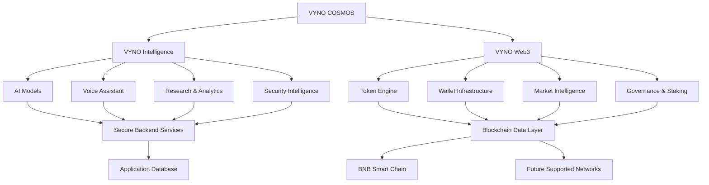

# ⚡ VYNO COSMOS
### The Intelligence of Digital Assets.

<p align="center">
  
</p>

<p align="center">
  
</p>

<h3 align="center">ENGINEERING THE NEXT DIGITAL FRONTIER.</h3>

<p align="center">
  <strong>ARTIFICIAL INTELLIGENCE × BLOCKCHAIN × DIGITAL ASSETS × AUTONOMOUS SYSTEMS</strong>
</p>

<p align="center">
  Building an intelligent digital ecosystem where AI, decentralized infrastructure, cryptographic research and digital assets converge.
</p>

<p align="center">
  <a href="https://www.vanhsya.com/"><strong>VANHSYA</strong></a>
  ·
  <a href="https://bscscan.com/token/0xe7c0e2229957300efcedd7455eda931f55bd7b10">VYNO Contract</a>
  ·
  <a href="#-documentation">Documentation</a>
  ·
  <a href="#-roadmap">Roadmap</a>
</p>

<p align="center">
  
  
  
  
  
</p>

---

# 🌌 01. The Vision

**VYNO COSMOS is an AI-powered Web3 technology initiative designed to bring intelligent software, blockchain infrastructure and digital asset intelligence into one unified ecosystem.**

The project explores a new generation of interconnected technologies:

- Artificial intelligence and autonomous intelligence systems.
- Blockchain infrastructure and decentralized applications.
- Digital asset analytics and tokenomics.
- Non-custodial wallet connectivity.
- Smart contract security intelligence.
- Decentralized governance and financial infrastructure.
- Multichain interoperability.
- Cryptographic research and post-quantum technology.

Rather than treating AI and blockchain as separate technologies, VYNO explores how they can work together through a modular, verifiable and extensible architecture.

**Our philosophy:**

> Intelligence beyond the interface. Infrastructure beyond the token.

# 🧬 02. The VYNO Ecosystem

VYNO is organized around interconnected technology domains.

| Ecosystem | Purpose |
|---|---|
| VYNO COSMOS | Unified AI and Web3 platform |
| VYNO Intelligence | AI research, analytics and intelligent automation |
| VYNO Web3 | Blockchain applications and decentralized infrastructure |
| VYNO Asset | Digital asset and token ecosystem |
| VYNO Quantum | Quantum-inspired research and cryptographic evolution |

These domains represent the product architecture and development direction. Their individual capabilities are implemented and released according to their respective development milestones.

## 🧠 VYNO Intelligence

An intelligence layer designed to connect AI models with structured application and blockchain information.

Potential capabilities:

- AI-powered blockchain research.
- Natural-language data analysis.
- Voice-enabled interaction.
- Market intelligence.
- Tokenomics interpretation.
- Portfolio analytics.
- Smart contract analysis.
- Security monitoring.
- Multilingual AI interaction.

AI-generated conclusions must be distinguishable from verified blockchain facts and external market information.

## 🔗 VYNO Web3

The decentralized technology layer.

Development areas:

- BNB Smart Chain integration.
- Token contract interaction.
- Wallet connectivity.
- Blockchain data indexing.
- Transaction monitoring.
- Digital asset analytics.
- Staking infrastructure.
- Governance systems.
- Treasury monitoring.
- Multichain architecture.

## 🪙 VYNO Asset

VYNO is the digital asset associated with the ecosystem.

The token's actual functionality, supply, permissions and market characteristics must be established from its deployed contract and independently verifiable blockchain information.

## ⚛️ VYNO Quantum

A research direction exploring:

- Post-quantum cryptographic standards.
- Cryptographic agility.
- Hybrid cryptographic architectures.
- Secure authentication.
- Key management.
- Future cryptographic migration strategies.

Quantum-inspired research does not automatically imply quantum computing or post-quantum security implementation.

# 🪙 03. Official VYNO Token

<p align="center">
  
</p>

<p align="center">
  <strong>VYNO — Digital Asset of the VYNO Ecosystem</strong>
</p>

| Property | Details |
|---|---|
| Token name | VYNO |
| Token symbol | VYNO |
| Blockchain | BNB Smart Chain |
| Network type | EVM-compatible |
| Mainnet Chain ID | 56 |
| Contract address | `0xe7c0e2229957300efcedd7455eda931f55bd7b10` |
| Explorer | BscScan |
| Contract verification | Check current explorer status |
| Token supply | Verify against deployed contract |
| Liquidity | Verify actual deployed trading pools |

**Official contract reference:**

[View VYNO on BscScan](https://bscscan.com/token/0xe7c0e2229957300efcedd7455eda931f55bd7b10)

The address above is the intended deployment supplied by the project owner. Always verify its identity, network and contract details before interacting.

## Token verification

Before interacting with VYNO:

1. Verify the contract address through an official project channel.
2. Confirm BNB Smart Chain as the network.
3. Inspect the contract on BscScan.
4. Confirm token name, symbol and decimals.
5. Check total supply and contract permissions.
6. Inspect the actual liquidity pools and trading pairs.
7. Review the token's transaction history.

A verified source-code listing does not independently establish that a smart contract is safe.

## Token utility and economics

The intended token utility and economic model must be documented transparently.

Potential ecosystem integrations may include:

- Ecosystem participation.
- Decentralized application integrations.
- Governance, if implemented.
- Staking, if implemented and funded.
- Digital asset utility.

No staking yield, voting entitlement, revenue distribution or other financial benefit should be assumed solely from holding VYNO.

# 🏛️ 04. System Architecture

VYNO COSMOS is designed around modular technology domains.

<p align="center">
  
</p>

## Conceptual architecture



This diagram represents the intended architecture. It does not claim that all modules or integrations are currently deployed.

## Core architectural domains

### 1. Application Layer

Responsible for:
- User interfaces.
- Dashboard components.
- Application navigation.
- User preferences.
- Responsive layouts.

### 2. Intelligence Layer

Responsible for:
- AI model integration.
- Natural-language processing.
- Context management.
- Research workflows.
- Blockchain data interpretation.

### 3. Blockchain Layer

Responsible for:
- RPC connections.
- Contract interactions.
- Blockchain events.
- Transaction verification.
- Network configurations.

### 4. Data Layer

Responsible for:
- Structured application data.
- Blockchain indexing.
- Historical market data.
- Analytics.
- Monitoring and diagnostics.

### 5. Security Layer

Responsible for:
- Authentication.
- Authorization.
- Secret management.
- Wallet signing boundaries.
- Smart contract analysis.
- Operational security.

# ⛓️ 05. Blockchain Infrastructure

## Primary network: BNB Smart Chain

VYNO prioritizes BNB Smart Chain as its initial blockchain integration.

Network configuration:

| Parameter | Value |
|---|---|
| Network | BNB Smart Chain Mainnet |
| Chain ID | 56 |
| Native asset | BNB |
| RPC | Configurable provider |
| Explorer | https://bscscan.com/ |

## Blockchain integration objectives

- Contract metadata retrieval.
- Token balance retrieval.
- Total supply monitoring.
- Transfer event indexing.
- Transaction history.
- Holder distribution.
- Liquidity monitoring.
- Wallet connectivity.
- Contract permission analysis.

## Future multichain architecture

The architecture is intended to support future integrations with:

| Network | Integration direction |
|---|---|
| Ethereum | EVM infrastructure |
| Solana | Solana-native infrastructure |
| Base | EVM infrastructure |
| Arbitrum | EVM infrastructure |
| Polygon | EVM infrastructure |

These are future integration targets, not claims of existing VYNO deployments on those networks.

Cross-chain transfers require independently evaluated bridge infrastructure and security controls.

# 📊 06. Digital Asset Intelligence

The market intelligence module is designed to provide transparent, source-attributed financial and blockchain information.

## Planned analytics

- Current token price.
- Historical price movements.
- Trading volume.
- Market capitalization.
- Liquidity pool information.
- Trading pair analytics.
- Holder distribution.
- Supply distribution.
- Burn activity.
- Transaction history.
- Wallet activity.

## Market data integrations

Potential data providers:

- DEX Screener.
- GeckoTerminal.
- PancakeSwap.
- Blockchain explorers.
- Compatible RPC providers.

Market information must identify its source and retrieval time.

Price estimates, pool prices and executable trade prices must not be treated as interchangeable.

# 👛 07. Wallet Infrastructure

The ecosystem is designed to support non-custodial wallet connectivity.

Potential wallet integrations:

- MetaMask.
- Trust Wallet.
- Rabby.
- WalletConnect-compatible wallets.

Planned capabilities:

- Wallet connection.
- Network detection.
- Token balances.
- Transaction history.
- Portfolio monitoring.
- Token approval inspection.
- Gas estimation.
- Transaction simulation.

**Security principle:** users retain control of their private keys and approve transactions through their connected wallets.

VYNO applications must never request wallet seed phrases or private keys.

# 🏦 08. Decentralized Finance & Tokenomics

Future decentralized financial infrastructure may include the following modules.

## Staking

Potential features:

- Token deposits.
- Staking positions.
- Lock periods.
- Reward calculations.
- Reward distribution.
- Withdrawal mechanisms.

Staking development is conditional on a verified tokenomics audit, sustainable reward funding, contract design and independent security review.

No APY is guaranteed or promised by this README.

## Governance

Potential features:

- Governance proposals.
- Voting.
- Proposal history.
- Governance analytics.
- Execution status.

Actual governance requires implemented voting rules and deployed infrastructure.

## Treasury

Potential capabilities:

- Treasury wallet monitoring.
- Asset allocation.
- Transaction tracking.
- Reserve reporting.
- Multisignature transaction workflows.

Financial transactions must remain under authorized human control.

# 🛡️ 09. Security & Cryptographic Research

Security is an architectural requirement.

## Application security

Development priorities:

- Secure API design.
- Authentication and authorization.
- Environment-specific secret management.
- Input validation.
- Rate limiting.
- Secure WebSocket communication.
- Dependency monitoring.
- Database access controls.
- Logging and incident monitoring.

## Smart contract security

Potential analysis areas:

- Access-control permissions.
- Ownership privileges.
- Minting permissions.
- Token transfer restrictions.
- Upgradeability.
- Pause mechanisms.
- Reentrancy risks.
- Transaction taxes.
- Wallet approval risks.

Automated scanning and AI-assisted analysis are not substitutes for independent smart contract audits.

## Post-quantum research

VYNO Quantum explores the evolution of cryptographic infrastructure.

Research priorities:

1. Established post-quantum standards.
2. Cryptographic agility.
3. Hybrid classical and post-quantum approaches.
4. Secure key management.
5. Authentication architecture.
6. Long-term migration planning.

No post-quantum security guarantee is made without documented implementation and validation.

# 🤖 10. AI & Autonomous Intelligence

The VYNO Intelligence direction explores AI-assisted digital asset and blockchain operations.

Potential AI capabilities:

| Intelligence module | Purpose |
|---|---|
| AI Oracle | Interpret verified blockchain information |
| Market Analyst | Analyze market data |
| Tokenomics Analyst | Interpret token supply and distribution |
| Contract Analyst | Explain contract functionality and risks |
| Portfolio Intelligence | Analyze connected asset information |
| Security Intelligence | Identify potential security concerns |
| Research Agent | Organize technical and market research |
| Voice Assistant | Enable conversational interaction |

AI agents must operate under explicit permissions.

AI must not autonomously control treasury funds, private keys or financial transactions.

# 🛠️ 11. Technology Stack

The implementation should use the dependencies and frameworks actually maintained by the repository.

Potential technology domains:

| Domain | Technology direction |
|---|---|
| Frontend | React and TypeScript |
| Application server | Node.js |
| API | Express or compatible backend |
| 3D environment | Three.js / WebGL |
| Blockchain | EVM-compatible libraries |
| Primary network | BNB Smart Chain |
| AI | Gemini and compatible model providers |
| Data | Appropriate database and indexing infrastructure |
| Cryptography | Reviewed cryptographic libraries |
| Testing | Unit, integration and security testing |
| Deployment | Versioned CI/CD infrastructure |

Do not describe proposed technologies as deployed dependencies unless they are present and configured in the project.

# 🚀 12. Installation & Development

## Prerequisites

- Git.
- Node.js 18+ or the version required by the project.
- npm or the repository's configured package manager.
- Access to configured external services where necessary.

Check your environment:

```bash
node --version
npm --version
git --version
```

## Clone the repository

```bash
git clone https://github.com/YOUR_USERNAME/YOUR_REPOSITORY.git

cd YOUR_REPOSITORY
```

Replace the example repository URL with the actual repository URL.

## Install dependencies

```bash
npm install
```

Use the existing package lockfile and package manager configuration.

## Environment configuration

If the project provides `.env.example`:

```bash
cp .env.example .env
```

Configure only the environment variables actually required by the application.

Illustrative placeholders:

```env
NODE_ENV=development
PORT=3000

# Blockchain infrastructure
BSC_RPC_URL=

# AI integration
GEMINI_API_KEY=

# Database configuration
DATABASE_URL=
```

These are example variable names. Confirm the actual configuration in the source code before using them.

Never commit `.env` files, wallet private keys or API secrets.

## Run the application

Inspect the available scripts:

```bash
npm run
```

Run the development command if it is configured:

```bash
npm run dev
```

## Build and test

Execute the scripts actually defined in the project:

```bash
npm test
npm run build
```

A successful build does not establish blockchain correctness, smart contract security or production readiness.

# 🧪 13. Testing & Quality Assurance

Quality assurance must cover all major system domains.

## Application testing

- Component testing.
- API integration testing.
- Authentication testing.
- Responsive interface testing.
- Accessibility testing.
- Error handling.

## Blockchain testing

- Network connectivity.
- Contract read operations.
- Token metadata.
- Balance verification.
- Transfer event indexing.
- Transaction confirmation.
- Wallet connection.
- Network switching.

## Smart contract testing

- Unit testing.
- Fuzz testing.
- Invariant testing.
- Access-control testing.
- Reentrancy testing.
- Economic attack testing.

## Infrastructure testing

- API performance.
- Database reliability.
- RPC provider fallback.
- WebSocket stability.
- Backup recovery.
- Monitoring and alerting.

Publish test results only when the relevant tests have actually been executed.

# 🗺️ 14. Development Roadmap

The following roadmap represents the intended development direction. Completion status must be updated using verifiable implementation evidence.

## Phase 0 — Project Audit

- [ ] Complete source-code inventory.
- [ ] Verify existing functionality.
- [ ] Audit the deployed VYNO contract.
- [ ] Reconcile tokenomics.
- [ ] Identify security issues.
- [ ] Document current architecture.

## Phase 1 — Blockchain Foundation

- [ ] Establish BNB Smart Chain connectivity.
- [ ] Implement token metadata retrieval.
- [ ] Implement balance and supply services.
- [ ] Build transaction indexing.
- [ ] Implement network monitoring.
- [ ] Validate blockchain data.

## Phase 2 — Digital Asset Intelligence

- [ ] Build market dashboard.
- [ ] Integrate market data providers.
- [ ] Implement liquidity analytics.
- [ ] Build holder analytics.
- [ ] Implement transaction explorer.
- [ ] Add portfolio analytics.

## Phase 3 — Wallet Infrastructure

- [ ] Integrate supported wallets.
- [ ] Implement network detection.
- [ ] Build token portfolio.
- [ ] Implement transaction previews.
- [ ] Add approval monitoring.

## Phase 4 — AI Intelligence

- [ ] Integrate blockchain-aware AI.
- [ ] Improve Gemini voice interaction.
- [ ] Build AI research tools.
- [ ] Implement tokenomics analysis.
- [ ] Add contract risk analysis.
- [ ] Build security intelligence.

## Phase 5 — Tokenomics & Staking

- [ ] Complete tokenomics audit.
- [ ] Define reward funding model.
- [ ] Design staking architecture.
- [ ] Complete independent contract review.
- [ ] Deploy only after authorization.

## Phase 6 — Governance & Treasury

- [ ] Design governance rules.
- [ ] Implement voting infrastructure.
- [ ] Develop treasury monitoring.
- [ ] Integrate multisignature controls.

## Phase 7 — Multichain

- [ ] Build modular network adapters.
- [ ] Evaluate additional EVM networks.
- [ ] Investigate Solana integration.
- [ ] Evaluate cross-chain infrastructure.
- [ ] Complete security reviews.

## Phase 8 — Production Readiness

- [ ] Complete security testing.
- [ ] Implement monitoring.
- [ ] Validate backup and recovery.
- [ ] Complete performance testing.
- [ ] Publish technical documentation.
- [ ] Complete applicable legal reviews.

# 📚 15. Documentation

Project documentation should cover:

- [ ] Architecture.
- [ ] Installation.
- [ ] Blockchain integration.
- [ ] Contract references.
- [ ] Tokenomics.
- [ ] API documentation.
- [ ] Wallet integration.
- [ ] Security architecture.
- [ ] AI integration.
- [ ] Staking.
- [ ] Governance.
- [ ] Deployment.

Documentation must reflect the actual implementation and current deployment status.

# 🤝 16. Contributing

Contributions that improve reliability, security, performance, documentation and maintainability are welcome.

Suggested workflow:

1. Fork the repository.
2. Create a focused feature branch.
3. Implement the change.
4. Add or update tests.
5. Run relevant checks.
6. Document significant changes.
7. Submit a pull request.

Do not submit secrets, credentials or unverified security claims.

# 📜 17. License

This project declares the MIT License.

See the `LICENSE` file for the applicable licensing terms.

Ensure the license file is present and reflects the project's intended distribution terms.

# ⚠️ 18. Disclaimer

VYNO COSMOS is a technology and software development initiative.

This repository and its associated documentation are provided for informational, research and development purposes.

- Digital assets involve substantial financial risk.
- Token prices can fluctuate significantly.
- Smart contract verification does not guarantee safety.
- AI-generated information can be inaccurate.
- Roadmap items are development objectives, not delivery guarantees.
- Proposed financial features are not necessarily deployed or operational.
- Cryptographic security depends on the implementation and threat model.
- Nothing in this repository constitutes investment, financial or legal advice.

Always independently verify contract addresses, network information and security claims before interacting with blockchain infrastructure.

---

<p align="center">
  
</p>

<h2 align="center">VYNO COSMOS</h2>

<p align="center">
  <strong>POWERED BY VANHSYA</strong>
</p>

<p align="center">
  <em>Build with precision. Secure with purpose. Engineer what comes next.</em>
</p>

<p align="center">
  <a href="https://www.vanhsya.com/">Official Website</a>
  ·
  <a href="https://bscscan.com/token/0xe7c0e2229957300efcedd7455eda931f55bd7b10">VYNO Contract</a>
</p>

<p align="center">
  <sub>Intelligence beyond the interface. Infrastructure beyond the token.</sub>
</p>
